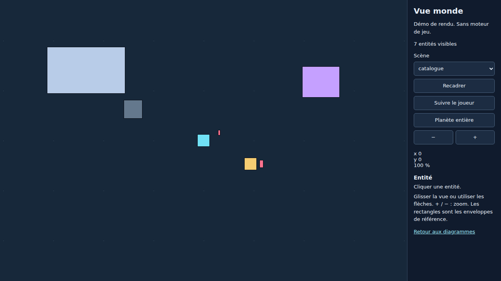
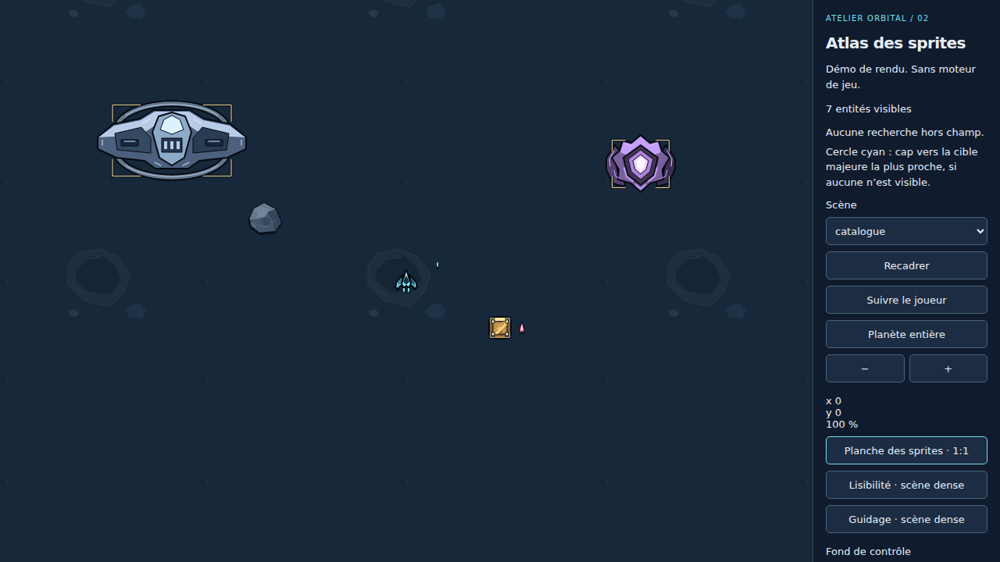
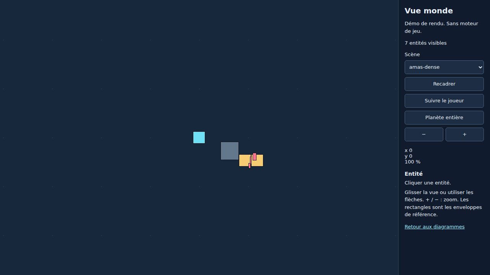
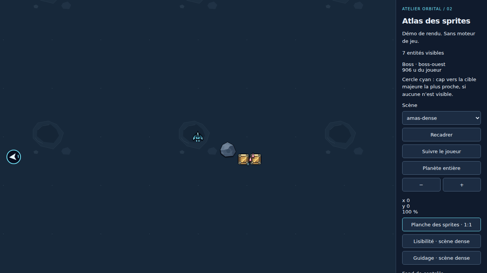
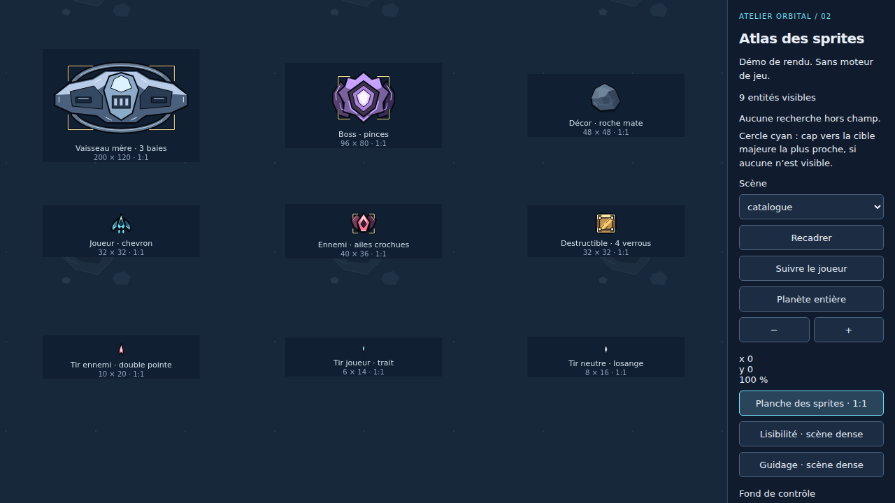

# Sprites intégrés — évolution 2

Après `npm run build` puis `npm start`, ouvrir `/jeu-demo.html`. Le convertisseur
reste à `/`. La scène est un banc de rendu sans moteur, sans commandes de combat,
sans dégâts ni simulation. La [flèche de cible](guidage.md) est désormais intégrée.

Les dix ressources de `public/jeu/sprites/` sont des SVG originaux créés pour ce
projet : aucun téléchargement, police, image ou service externe. Leur origine,
leur licence et leurs dimensions sont décrites dans
[le manifeste des ressources](../../public/jeu/sprites/README.md).
La direction artistique de l'évolution 0 est appliquée : contre-contour sombre,
arêtes claires, plaques à plusieurs valeurs, lumière supérieure gauche, métal
cyan/violet/bleu, quatre verrous dorés sur les caisses, rochers mats atténués,
aiguilles roses à double pointe pour les tirs ennemis. Le fond reçoit des
cratères sombres sous les sprites ; aucun effet ne recouvre le HUD.

Le bouton « Planche des sprites · 1:1 » expose les neuf variantes à leur taille
nominale, sans dépendre de la présence des entités dans un scénario. Elle inclut
l'ennemi standard (nouvelle catégorie facultative `ennemi`), les tirs des trois
origines, le boss à pinces et le vaisseau mère allongé à trois baies et anneaux.
Les fixtures v1 restent inchangées, sans ennemi standard inventé dans leurs
instantanés. La planche se réorganise au redimensionnement, y compris à 360×640.
Choisir un scénario ou « Recadrer » revient aux positions de référence.

`sprites.ts` définit les fichiers, dimensions et pivots explicites `(0.5, 0.5)`.
Les sources ont une taille déclarée de 2× la taille nominale et un `viewBox`
vectoriel ; le rendu reste net aux DPR 1, 1.5 et 2. L'avant est orienté vers −Y,
l'angle est en radians, positif dans le sens horaire en coordonnées écran.
L'ajustement est uniforme, même si l'enveloppe fournie a d'autres proportions ;
un sprite tourné est contenu dans cette enveloppe sans déformation. Les
positions projetées, dimensions logiques, visibilité et sélection d'enveloppe
restent celles de `camera.ts`. Le pivot ne tremble pas pendant les effets.

`RectangularView` reçoit les images décodées par `loadSprites()` en troisième
argument. Le chargement échoue explicitement avec le nom de la ressource
manquante plutôt que d'afficher une scène incomplète. `setPresentation` reçoit
un dictionnaire indépendant `{id: {orientation, state, progress}}` : les cinq
états sont `repos`, `deplacement`, `tir`, `impact`, `destruction`, et `progress`
va de 0 à 1. Le futur moteur pourra fournir ces informations sans modifier ses
positions, volumes de collision ou valeurs de dégâts. Les instantanés du moteur
ne sont jamais modifiés. Les états inactifs/détruits restent exclus du rendu.

Le panneau permet de scruter orientation et transition à l'arrêt, ou de lire
une transition de 150 ms. Traînées, éclat de tir, impact et débris sont des
échantillons visuels, pas des événements de jeu simulés. Leur opacité ajoutée
ne dépasse pas 35 %. La destruction fait disparaître progressivement le sprite,
avec des débris contenus ; elle ne change pas l'état logique de l'entité.
Aucune animation continue ne clignote ; les RAF et l'observation du DPR sont
arrêtés à la fermeture. Les orientations et états peuvent être combinés.

## Captures et comparaison

Les [captures conservées](captures/) sont des PNG à DPR 1 et à l'échelle réelle.
Les fichiers `avant-catalogue-1280x720.png` et `avant-amas-dense-1280x720.png`
proviennent du renderer de l'évolution 1 avant modification, avec son interface.
`avant.json` conserve les caméras, rectangles et IDs visibles de ce renderer.
Les captures `apres-*` emploient les mêmes fixtures, caméras et échelles ;
le panneau a évolué, la zone monde reste identique. Les fichiers `planche-*`
montrent toutes les variantes dans les quatre formats demandés. `gris-amas-*`
permet de contrôler la distinction par forme indépendamment de la couleur.
Les fichiers `etat-*` montrent déplacement, tir, impact et destruction.

| Avant, 1280×720 | Après, même scène et cadrage |
| --- | --- |
|  |  |
|  |  |

Les tests régénèrent les captures après, les planches et les états. Les captures
avant et leur manifeste sont des références immuables. L'examen visuel confirme
les contours propres, les volumes lisibles et les silhouettes distinctes sur
la planche, en scène et en niveaux de gris. Un sprite au bord du viewport est
naturellement tronqué par la fenêtre ; ses pixels source restent intacts.

## Vérification et audit des tests

`npm test` découvre tous les cas, compile les ressources et exécute les tests du
convertisseur, de préparation, de caméra et de sprites. Chaque cas se relance
avec `node scripts/test.mjs NOM_EXACT_DU_CAS`, même après suppression de `dist/`.
`npm run typecheck` contrôle les trois configurations TypeScript.
Les quatre recettes Python de préparation ont été intégrées, avec leurs
assertions et leurs noms conservés, dans `tests/jeu-preparation.test.mjs` :
elles font désormais partie de la suite et nécessitent Python 3.

Les anciens cas navigateur suivants sont effectivement remplacés dans
`tests/jeu-browser.test.mjs` :

| Cas supprimé | Attente obsolète | Remplacement |
| --- | --- | --- |
| `jeu-navigateur-coins-centre-hors-champ-et-pixels` | Centre de chaque enveloppe exactement doré et uniforme | `jeu-sprites-coins-centre-hors-champ-et-fond` : pixels du sprite, coins, centre, tangences et états |
| `jeu-navigateur-planete-circulaire-bords-et-proportions` | Rectangle plein étiré à 30×18 pixels | `jeu-sprites-planete-circulaire-bords-et-proportions` : vraie empreinte proportionnée dans la même enveloppe, disque, quatre bords et hors planète |
| `jeu-navigateur-dpr-un-deux-et-changement-a-chaud` | Pixel central exactement identique à l'aplat provisoire | `jeu-sprites-dpr-nettete-selection-et-changement-a-chaud` : ressource visible, backing store, sélection et DPR à chaud |
| `jeu-navigateur-scenarios-informations-et-retour-diagrammes` | Supposait le formulaire immédiatement prêt après navigation, avant exécution du module | `jeu-sprites-scenarios-hud-mobile-et-commandes` et `jeu-sprites-retour-diagrammes-initialisation-retardee-et-conversion` |

Les autres attentes préexistantes restent requises. Aucun test du convertisseur
n'est retiré. `tests/jeu-sprites.test.mjs` ajoute six cas : transparence et bords
source, masques de silhouettes, valeurs d'ombrage, planche et scènes aux quatre
formats, comparaison de cadrage, transitions et immuabilité des métadonnées,
chargement local avec réseau distant bloqué et diagnostic de ressource absente,
puis raster des neuf variantes dans cinq orientations avec disparition finale.

Le cas vide et toujours ignoré `jeu-moteur-reel-deplacement-tir-et-collisions`
est supprimé de la suite. Il est remplacé par
`jeu-sprites-succession-instantanes-figes-suivi-tirs-et-etats` dans
`tests/jeu-snapshots.test.mjs`, réellement exécuté. Ce test transmet quatre
instantanés profondément gelés au renderer : référence, position modifiée,
projectile activé, objet détruit. Il contrôle le suivi, la sélection projetée,
les IDs visibles, l'intégrité de tous les instantanés et des métadonnées opaques
de collision/dégâts, puis le retour au premier instantané. Il ne calcule aucune
règle de combat et ne prétend pas remplacer les replays d'un moteur réel.

La recette externe `node scripts/verify-jeu-engine.mjs` reste **not-run** pour
le contrôle du moteur : elle est séparée de la découverte des tests automatisés.
Sans moteur fourni, elle explique les prérequis et sort avec le code 2 ; ce
résultat n'est pas une réussite de test. Prochaine action : fournir le moteur,
son adaptateur et un script Node de replays avec assertions comparant avant/après
positions, tirs, collisions et dégâts, puis définir `JEU_ENGINE_VERIFICATION`
vers ce script et relancer la recette. Le script transmet le véritable code de
sortie, sans assertion simulée. La suite locale ne contient plus de cas ignoré
pour le moteur absent. Les recettes natives historiques du convertisseur
restent indépendantes de la démonstration web.

Le retour aux diagrammes attend désormais l'initialisation effective du formulaire
avant d'en contrôler la disponibilité. Le nouveau cas retarde volontairement la
requête du module `main.js` à l'aide d'une promesse contrôlée : il observe d'abord
l'état HTML désactivé, libère le module, attend le formulaire prêt puis réalise
la conversion de référence (18 nœuds, 24 arcs). Il n'utilise ni pause arbitraire,
ni nouvelle tentative masquant un échec. Le second cas conserve les douze
scénarios, les informations et les commandes de suivi/planète en fenêtre étroite.
Ce remplacement corrige une attente prématurée du test ; aucun changement du
chargement normal de l'application n'est nécessaire.
